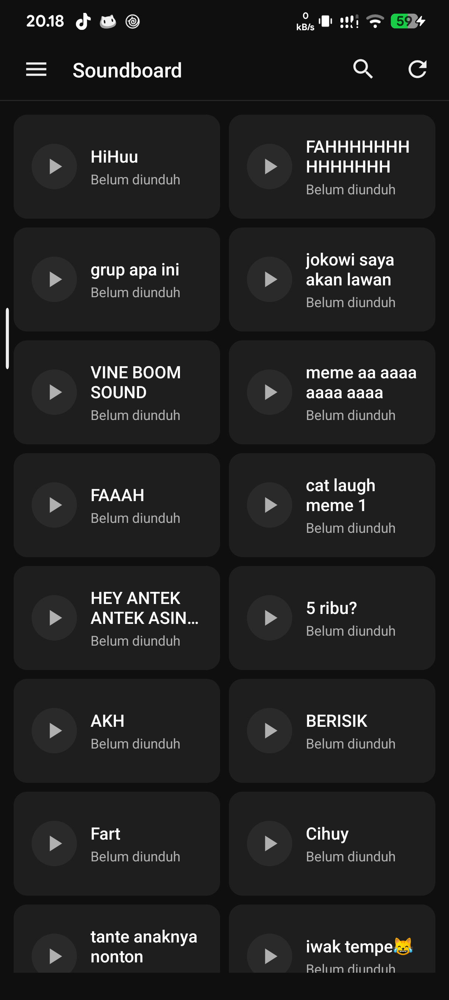
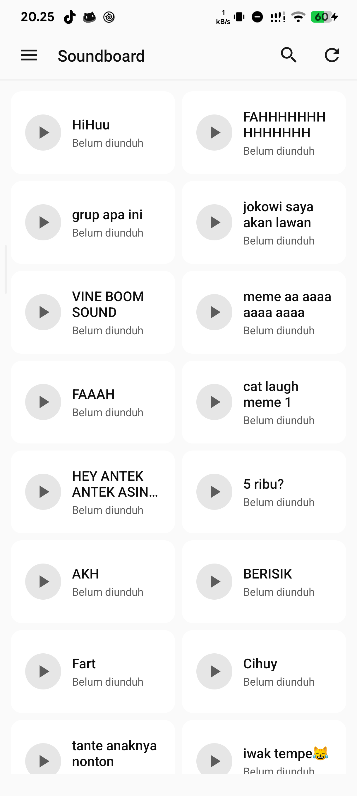
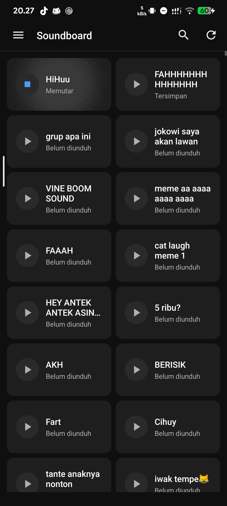
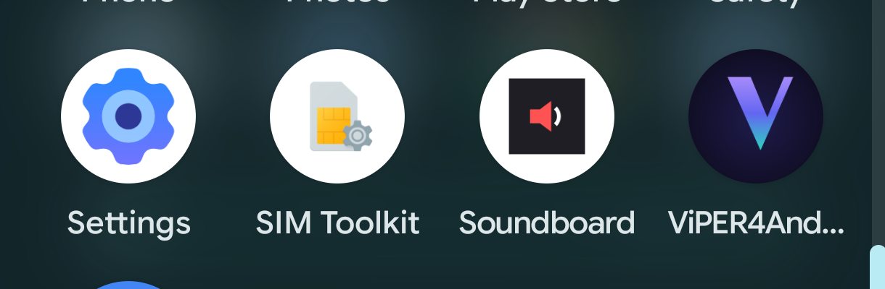

# Soundboard

Unofficial personal sound browser for [myinstants.com](https://www.myinstants.com/).

Sound list, search and playback are native Android views. The website is only used to sync the catalog and download audio, so the app still opens and plays cached sounds without a connection.

| Dark | Light | Playing |
| --- | --- | --- |
|  |  |  |



## What it does

- Syncs sound names from the public listing pages (16 sources, 3 pages each) into a local catalog in `filesDir`.
- Shows the catalog as a two column grid with a play/stop state per sound.
- Downloads audio on first tap, keeps up to 200 MB in an LRU cache, and plays it with `MediaPlayer` and audio focus.
- Filters the list as you type. Empty, no-match, sync-failed and offline states each have their own screen.
- Menu: Sinkronkan, Buka situs, Hapus cache, Kredit.
- Light and dark theme follow the system setting.

No ads, no analytics, no third party libraries. `minSdk 24`, `targetSdk 34`, Java and XML only.

## Build

```bash
gradle assembleDebug
```

APK output: `app/build/outputs/apk/debug/app-debug.apk`.
Every push to `main` builds and publishes a release with the workflow in `.github/workflows/build.yml`.

## Credits

- All sounds, branding and website content belong to myinstants.com and its uploaders.
- This app is not affiliated with myinstants.com.
- For personal use only, not for redistribution.
